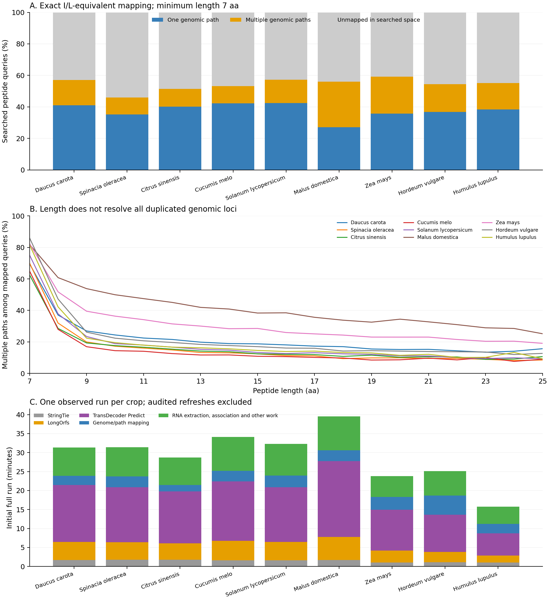

> Historical classification note: the Casanovo proposal counts below predate
> the correction separating same-frame refinements from novel ORFs. An audit
> found 18,515 candidate models in both lists. Use those historical counts as
> overlapping event reports, not distinct novel-ORF counts. Genomic mapping
> results and ambiguity counts are unaffected. The corrected classifier and
> blinded gene-removal evaluation are described in
> [the RefSeq follow-up](refseq_20261102/README.md).

# GAPMS 1.0.0: nine-crop Casanovo evaluation

All nine integrated biological jobs completed successfully, followed by audited
evidence refreshes and independent coordinate/metadata checks. Results are in
`~/GAPMS/0-raw_files/<crop>/outputs/gapms/GAPMS_V1_casanovo`.

Each run used assembly, Helixer annotation, sorted VARUS BAM and the crop's
`outputs/casanovo/*.casanovo_peps.tsv`. Exact matching used I/L equivalence,
minimum peptide length 7, eight threads, and the default supported-splice limits.
One-edit rescue was disabled. Input quality metrics were absent; quality remains
unknown. No event was promoted to `high_confidence_candidate`.

## Mapping and reference coverage

Peptide counts below are unique normalized query labels at least seven amino
acids long. I/L aliases retain labels, while model evidence counts collapse them.
`Multiple` is the number of query labels with more than one distinct genomic path.
Counts do not measure peptide identification accuracy.

| Species | Searched | Mapped | Mapped % | Unique | Multiple | Verified reference coverage | Verified reference misses |
|---|---:|---:|---:|---:|---:|---:|---:|
| Daucus carota | 244,469 | 139,641 | 57.12 | 100,438 | 39,203 | 99.9340% | 45 |
| Spinacia oleracea | 274,972 | 126,480 | 46.00 | 96,911 | 29,569 | 99.9470% | 29 |
| Citrus sinensis | 285,351 | 146,578 | 51.37 | 114,712 | 31,866 | 99.9370% | 45 |
| Cucumis melo | 240,816 | 128,032 | 53.17 | 101,630 | 26,402 | 99.9597% | 38 |
| Solanum lycopersicum | 268,225 | 153,622 | 57.27 | 114,068 | 39,554 | 99.9342% | 47 |
| Malus domestica | 264,193 | 148,057 | 56.04 | 71,780 | 76,277 | 99.9622% | 35 |
| Zea mays | 289,137 | 170,910 | 59.11 | 103,302 | 67,608 | 99.9578% | 41 |
| Hordeum vulgare | 299,578 | 162,877 | 54.37 | 110,311 | 52,566 | 99.9649% | 32 |
| Humulus lupulus | 254,120 | 139,955 | 55.07 | 97,452 | 42,503 | 99.9221% | 52 |

Across crops, **1,316,152/2,420,861 searched queries mapped**.
A further 84,134 distinct normalized sequences
were reported as below the seven-AA threshold; the tool did not silently label
these as genomically absent. Original identification records retained:
**2,747,138**.

The historical comparison uses each crop's
`outputs/gapms/casanovo/helixer/prediction_search/peptides_mapped.bed`.
Negative-strand display labels are restored, I/L is canonicalized, and adjacent
blocks are merged before comparison. Every eligible historical interval was
independently extracted and translated with BioPython against the supplied
assembly. **707,306/707,670 sequence-reproducing reference loci were
recovered (99.9486%)**. The 364 remaining sequence-compatible
reference paths all require at least one splice junction absent from the
provided annotation and retained RNA evidence. **No sequence-reproducing
contiguous reference location was missed.** These are reference-concordance
measures, not a truth-set precision estimate.

Many historical intervals do not reproduce their peptide label at their exact
reported coordinates in the supplied assembly. Their protein assignments may
still be useful evidence, but exact-coordinate agreement with those intervals
cannot validate the newly reported peptide path. Both raw overlap and the
sequence-reproducing subset are retained in the detailed JSON; no discordant
reference records were hidden. The cause of an individual discrepancy requires
inspection of the original run, annotation and coordinate-generation history.

## Historical coordinate audit (all eligible reference records)

The raw denominator below includes every historical locus for a queried peptide
at least seven amino acids long. The assembly-translation check is performed
before calculating the sequence-reproducing subset, independently of whether
v1 recovered the location. Thus the reference filter does not select on v1
agreement.

| Species | Eligible historical loci | Raw coordinate overlap | Sequence-reproducing historical loci | Historical loci not reproducing the label |
|---|---:|---:|---:|---:|
| Daucus carota | 177,971 | 68,133 | 68,178 | 109,793 |
| Spinacia oleracea | 138,918 | 54,646 | 54,675 | 84,243 |
| Citrus sinensis | 174,027 | 71,371 | 71,416 | 102,611 |
| Cucumis melo | 216,797 | 94,297 | 94,335 | 122,462 |
| Solanum lycopersicum | 182,078 | 71,394 | 71,441 | 110,637 |
| Malus domestica | 236,859 | 92,544 | 92,579 | 144,280 |
| Zea mays | 250,745 | 97,057 | 97,098 | 153,647 |
| Hordeum vulgare | 209,231 | 91,164 | 91,196 | 118,035 |
| Humulus lupulus | 167,544 | 66,700 | 66,752 | 100,792 |

## Independent checks

- Every reported genomic hit was verified by the mapping/projection stages.
- A fixed-seed reservoir sample of 18,000
  peptide paths was independently translated with BioPython, including spliced
  and negative-strand mappings where sampled.
- 18,000 whole candidate ORFs were independently
  reconstructed from projected GTF CDS segments and compared to the exported
  protein FASTA. The checker handles strand and first CDS phase independently.
- All BED12 rows were checked for schema and counts. Summary identities,
  mapping multiplicity and unmapped counts agree.
- 79,685 event–peptide associations
  were checked against the evidence store. Start and splice events require the
  appropriate protein position or direct junction crossing.
- All original table rows were retained, including duplicate identifications
  and modification labels. Normalized search files and every mapped peptide ID
  and quality label were proven unchanged during the metadata correction.
- Input identities were checked before and after every biological workflow.
  Original FASTA/BAM/annotation files and prior results were preserved.

## Candidate annotation events

Events are review candidates with diagnostic placements, source identities,
full coordinates, multiplicity, RNA observations and explicit limitations.
Counts across event types can refer to the same ORF and must not be added as a
count of distinct new genes. Unknown identification quality precludes high-
confidence candidate status. Equally compatible coding structures remain
ambiguous even at a unique locus.

| Species | Candidate ORFs searched | Novel ORF candidates | Start candidates | CDS-end candidates | Splice candidates |
|---|---:|---:|---:|---:|---:|
| Daucus carota | 48,468 | 2,603 | 14 | 479 | 1,817 |
| Spinacia oleracea | 43,801 | 2,918 | 9 | 431 | 1,931 |
| Citrus sinensis | 43,099 | 2,631 | 12 | 419 | 1,812 |
| Cucumis melo | 49,963 | 3,429 | 17 | 406 | 2,131 |
| Solanum lycopersicum | 45,090 | 3,040 | 13 | 345 | 2,285 |
| Malus domestica | 62,907 | 3,510 | 25 | 755 | 2,306 |
| Zea mays | 58,282 | 4,364 | 9 | 554 | 2,421 |
| Hordeum vulgare | 50,906 | 2,743 | 7 | 381 | 1,514 |
| Humulus lupulus | 35,497 | 2,331 | 14 | 376 | 1,105 |

These proposals do not automatically modify the input annotation. Single-peptide,
partial and ambiguous ORFs remain inspectable. RNA junction observations alone
do not prove full-length transcript connectivity; the engine's path-search
caps and scope remain part of each run's mapping summary.

## Runtime

These are single observed runs, not replicated performance comparisons. Initial
full-run timings include real StringTie and TransDecoder execution plus mapping
and initial evidence export. The final evidence-only refresh applied stricter
placement/ORF ambiguity rules while reusing verified unchanged biological
stages. The last metadata-only correction retained original one-column table
records and did not rerun or change biological mappings. Refresh durations are
reported separately rather than presenting them as fresh full runs.

| Species | Initial full run (min) | Genome/path engine (min) | StringTie (min) | LongOrfs (min) | TransDecoder Predict (min) | Evidence refresh (min) |
|---|---:|---:|---:|---:|---:|---:|
| Daucus carota | 31.37 | 2.39 | 1.69 | 4.74 | 15.06 | 3.77 |
| Spinacia oleracea | 31.39 | 2.91 | 1.75 | 4.61 | 14.48 | 3.65 |
| Citrus sinensis | 28.71 | 1.65 | 1.79 | 4.30 | 13.72 | 3.46 |
| Cucumis melo | 34.11 | 2.77 | 1.62 | 5.15 | 15.63 | 4.38 |
| Solanum lycopersicum | 32.26 | 3.04 | 1.65 | 4.78 | 14.47 | 4.31 |
| Malus domestica | 39.54 | 2.82 | 1.67 | 6.14 | 19.96 | 4.67 |
| Zea mays | 23.77 | 3.37 | 1.07 | 3.11 | 10.76 | 6.06 |
| Hordeum vulgare | 25.12 | 5.04 | 1.12 | 2.73 | 9.81 | 3.31 |
| Humulus lupulus | 15.74 | 2.51 | 1.01 | 1.86 | 5.84 | 4.44 |

TransDecoder prediction and RNA processing dominate the full integrated runs;
the direct peptide mapper is only one part of that cost. The new orchestration
uses a single genome/path search and one RNA-junction extraction across the
union of annotation and candidate models. The protein automaton is built once
for the combined model FASTA. Assembly indexing stays in the output directory.

## Jobs, audit history and artifacts

Biological jobs: `193491`–`193499`. Evidence refresh jobs: `193503`–`193511`.
Metadata audit jobs: `193533`–`193541`. Final aggregate audit: `193542`.
The initial carrot pilot `193488` exposed unstranded StringTie transcripts and
was corrected before the nine final biological runs. Its failed outputs/logs
are preserved separately. Superseded waiting validation jobs were cancelled
when validation was parallelized; they do not represent biological failures.

Implementation-stage provenance records the source fingerprint, input identities,
external versions and command arguments. Audited refreshes compare against
archived wheels, prove unchanged biological modules/query space, preserve prior
manifests and record the reason for each refresh. This is explicit reuse of
compatible completed stages rather than bypassing arbitrary resume mismatches.

Local job scripts, full per-crop validation, archived development wheels, and
raw/comparable reference counts are in
`~/GAPMS/batch_runs/v1_casanovo_20261102/`. Portable analysis/checking scripts are
included under `scripts/`. Release tables and plots accompany this report.

## Length and ambiguity

Among mapped queries pooled across the nine datasets, 59.77% of 7–8-AA queries
had multiple genomic paths, compared with 25.79% at 9–11 AA, 20.84% at 12–14 AA
and 16.58% at 15 AA or longer. These are query-weighted descriptive counts, not
independent biological replicates. Long peptides can still match duplicated
genes, particularly in apple and maize.

The seven-AA exact-search default retains useful short evidence while labeling
its ambiguity. Downstream locus-specific analyses should inspect multiplicity
and can apply stricter length thresholds; length alone cannot establish
uniqueness. Exploratory one-edit rescue remains off by default and uses a
separate minimum of 12 AA when requested.

[PDF figure](evaluation.pdf), [release table](release_results.tsv),
[summary data](release_results.json), and
[length-stratified data](ambiguity_by_length.json). The figure can be regenerated
with `python plot_results.py` from this directory.

## Full ORF projection audit

All **438,013** candidate ORF proteins were compared with TransDecoder's original
transcript-space predictions. **438,011** matched literally. Two differed only
because TransDecoder reports X at deterministic ambiguity-coded codons (one
residue in tomato, seven in apple). For these two, genomic and transcript CDS
sequences were proven nucleotide-identical, and every possible concrete codon
was enumerated and required to encode exactly the reported residue. There were
**zero unexplained projection differences**. This distinguishes a representation
difference from a coordinate error rather than ignoring the initial failed
literal-comparison assertion.

The literal-only audit job `193547` flagged both cases. The stronger nucleotide
and codon-enumeration audit `193549` passed. The final uncertainty annotation
audit `193554` recorded unresolved residues explicitly and proved placements and
confidence counts unchanged. High-confidence candidate status is prevented for
unresolved ORF sequences; the suite now passes **129 tests** (105 legacy and
24 v1 tests). [Per-crop full-ORF audit counts](orf_projection_audit.json).
