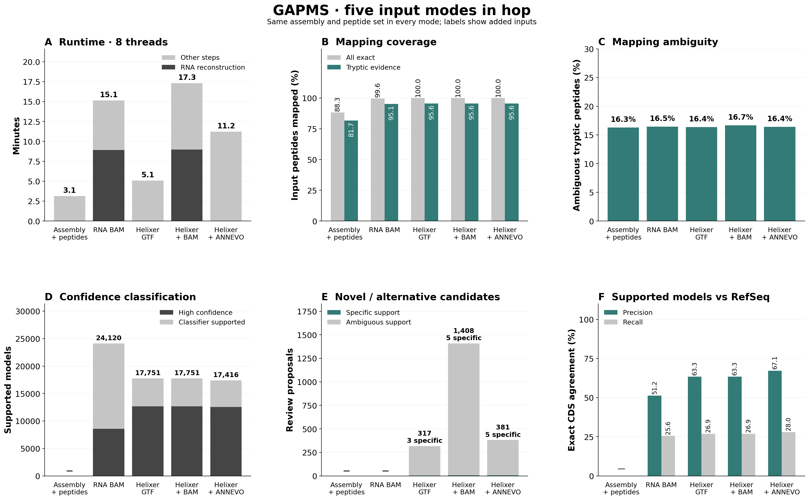

# GAPMS: five input modes in hop

Evaluated **Humulus lupulus**, the fastest crop in the previous nine-crop full-pipeline run. Each mode used the same assembly and 163,753 Helixer FragPipe peptides. Every invocation omitted `-t` and `-o`, exercising the defaults of **8 threads** and **`./GAPMS_output`**. RNA runs used the sorted VARUS BAM; the two-annotation run used Helixer and ANNEVO. RefSeq was used only for evaluation, never for mapping or consensus.



[SVG](figures/five_modes_final.svg) · [PDF](figures/five_modes_final.pdf) · [Full statistics](results_final.tsv)

## Results

| Mode | Minutes | All mapped | Tryptic evidence | Ambiguous among tryptic | Supported models | Peptide-supported RNA ORFs | Review proposals |
|---|---:|---:|---:|---:|---:|---:|---:|
| Assembly + peptides | 3.13 | 144,618 | 133,744 | 16.29% | 0 | 0 | not assessed |
| + BAM | 15.13 | 163,150 | 155,790 | 16.46% | 24,120 | 25,290 | not assessed |
| + Helixer GTF | 5.08 | 163,753 | 156,511 | 16.37% | 17,751 | 0 | 317 |
| + Helixer GTF + BAM | 17.29 | 163,753 | 156,515 | 16.66% | 17,751 | 25,290 | 1,408 |
| + Helixer GTF + ANNEVO GTF | 11.21 | 163,753 | 156,513 | 16.42% | 17,416 | 0 | 381 |

These peptides were identified against Helixer-derived proteins. Complete recovery with the matching Helixer GTF is therefore an implementation-consistency check, not an independent test of novel-peptide sensitivity. All mapped refers to exact/I/L-equivalent placements, including non-tryptic contexts. Tryptic evidence is the default set used by scoring, consensus and proposals. Its ambiguity denominator is the number of peptides with at least one eligible placement, rather than every input peptide. A dash in the figure means the analysis is not applicable; it does not mean that there are no undiscovered genes. Candidate counts are proposals, not confirmed discoveries or distinct genes.

The all-mapping BED and tryptic BED are both retained. Their multiplicities are calculated independently. Protein specificity uses only enzyme-compatible occurrences in the relevant protein pool; a compatible context in one isoform does not qualify a non-tryptic context in another isoform. Possible methionine starts and initiator-methionine removal remain plausible exceptions, not proven translation starts.

## Scientific and technical checks

Independently verified 3,856,448 reported genomic placement rows, 1,382,004 protein associations and 50,580 peptide-supported RNA ORF model checks across the five final modes. Each BAM run contains 25,290 peptide-supported ORF models; the cross-run sum is not a count of distinct genes. Checks used HTSlib/pysam and BioPython independently of PepLocus mapping/projection code.

Checks covered block lengths and bounds, both strands, translation identity, BED12 and IGV conventions, all/tryptic uniqueness counts, cleavage eligibility in each protein context, supported-model/score agreement, duplicate proposals, and splice boundaries already explained by any supplied annotation. Full-CDS comparisons against RefSeq are coordinate- and strand-specific; RefSeq is a benchmark rather than an error-free biological truth.

Exact CDS precision and recall measure complete structural agreement with RefSeq, not peptide-spectrum identification precision. Selecting supported models can improve precision while lowering recall because unsupported models are deliberately omitted. This is not automatic repair of every Helixer model.

The search of supported splice combinations and local refinements is bounded. Nine local splice contexts reached the 64-path limit in the annotation runs; the genomic supported-junction search did not reach its path cap. This limits candidate-path completeness and uniqueness claims, while the supplied-model CDS projections still recovered every input peptide. Uniqueness is relative to the searched paths; inspect `search_capped` in the audit JSON before interpreting a unique placement as globally unique. The five modes supply different splice paths, so more evidence can improve coverage while also exposing more ambiguity. All evaluation runs used `--keep-work` so that raw evidence could be audited; runtime therefore excludes the default final deletion of temporary files.

### Fixed: novelty cannot be inferred without annotations

The earlier BAM-only branch could put peptide-supported RNA ORFs in a novel-ORF review track despite having no annotation against which to assess novelty. The correction retains those ORFs and their evidence, but makes no novelty or alternative-event claim without an input annotation. The corrected BAM-only assessment was replayed from the retained, strictly filtered evidence database. Hashes verify that mapping BEDs, classifier scores, supported structures and non-event ORF evidence did not change. RNA reconstruction and peptide searches were not repeated for this correction. The replay provenance is in the earlier `baseline/bam/` and `optimized/bam/` outputs under `diagnostics/novelty_revision/complete.json`. The final `stable/bam/` run includes the correction from the beginning.

### Fixed: an enzyme filter must not erase existing isoform explanations

The GTF+BAM audit found two proposals that included peptide occurrences already explained by supplied Helixer isoforms as diagnostic evidence. Those annotation occurrences failed the enzyme filter and had therefore been omitted from the novelty comparison. Support and classification still use tryptic evidence; novelty exclusion now checks all exact annotated occurrences. One proposal was removed and the already-explained peptide was removed from another proposal that retained other diagnostic support. The affected assessment was replayed on the earlier runs, with mapping, scores and non-event evidence checked unchanged. All final runs include the fix from the beginning.

## Avoiding repeated work

1. Annotation/RNA junctions are extracted once in GAPMS and passed to PepLocus as a source-aware union. Zero-read annotation junctions remain eligible; RNA-only edges still require the configured read support. The GTF is not parsed a second time inside PepLocus.
2. One protein peptide automaton is shared across source, graph and consensus searches. A bounded LRU cache reuses occurrence searches for identical I/L-normalized protein sequences, while retaining every protein ID and occurrence. It caches at most 32 million residues and one million pattern hits.
3. The combined-source protein pool is searched once initially. Genome mapping and protein association serve different purposes and retain distinct coordinate/cleavage checks. StringTie reconstruction and BAM junction counting also supply different evidence, so those two BAM operations remain separate.
4. Public tracks share disk blocks with diagnostic tracks through hard links when supported. No new speed-control flags were added.

The controlled protein-search comparison produced byte-identical mapping TSVs: original 10.34 s versus cached 7.53 s, with 45,314 reused sequences and 51,543 actual sequence scans. This measures the complete sequence-search/output calls on one Slurm task; timing includes shared-filesystem variability.

The whole-pipeline before/after runs used shared Slurm nodes and shared storage with uncontrolled filesystem caching. Their wall times are useful observations, not a controlled speedup estimate. In particular, the unchanged assembly-only code also ran faster in the later wave. The figure uses five complete final runs on the same compute host, node07, with the exact final implementation. All five use 8 threads and retain temporary work for audit. Earlier assessment-only correction times are not included in the final cohort. `final_cohort.json` identifies the exact run used for each mode.

### Fixed: reproducible RNA ORF boundaries

The unseeded BAM-only and GTF+BAM runs assembled identical transcript structures but produced 1,099 different CDS structures in the symmetric difference, despite having identical RNA inputs. TransDecoder 5.5.0 seeds its PWM random number generator, but Perl hash iteration also affects start refinement. GAPMS now fixes `PERL_HASH_SEED=0` and `PERL_PERTURB_KEYS=0` only for TransDecoder child processes and records those two controls. The initial hash-order control alone was insufficient because StringTie assigned different transcript names/order to identical structures. GAPMS now canonicalizes transcript and gene IDs from their genomic structures and gene groups before FASTA extraction, retaining raw StringTie output and an ID provenance table. The independently assembled 43,140 transcript models produce byte-identical canonical RNA FASTAs. Both BAM modes were rerun end-to-end; `rna_reproducibility.json` requires identical ORF coordinates and byte-identical RNA protein FASTAs. These are now the BAM runs used in the figure.

## Reproducibility

- `inputs.json`: exact input paths and the five mode configurations.
- `execution/`: command arguments, stage timings, return codes and job identifiers. Stage timers are inclusive and must not be summed when they are nested.
- `audit/final/*/audit.json`: independent per-mode checks and RefSeq structural comparisons.
- `baseline/`, `optimized/`, `seeded/` and `stable/`: separate execution result directories; earlier assessment corrections have explicit provenance. The final cohort uses `stable/` for all five modes, on the same compute host.
- `baseline_site/`, `optimized_site/`, `final_site/`, `stable_site/`: exact implementation snapshots. The stable snapshot adds novelty/isoform guards and deterministic TransDecoder controls and is byte-identical to the 1.3.2 package.
- `tests_132_stable.out`: 119 passing regression tests, including digestion, isoforms, bounded search reuse and junction reuse.
- `package_verification.json`: release hashes and byte identity of all 60 Python modules among source, wheel and local installation.
- `protein_reuse_benchmark.json`: byte-for-byte comparison of original and cached protein mapping.
- `jobs.json`, `accounting.tsv`: Slurm submissions and completed accounting.

GAPMS 1.3.2 is built locally, not uploaded to PyPI or GitHub and no container was rebuilt. Install the local wheel with:

```bash
python -m pip install /home/students/q.abbas/GAPMS/batch_runs/five_modes_hop_20261113/dist/gapms-1.3.2-py3-none-any.whl
```
