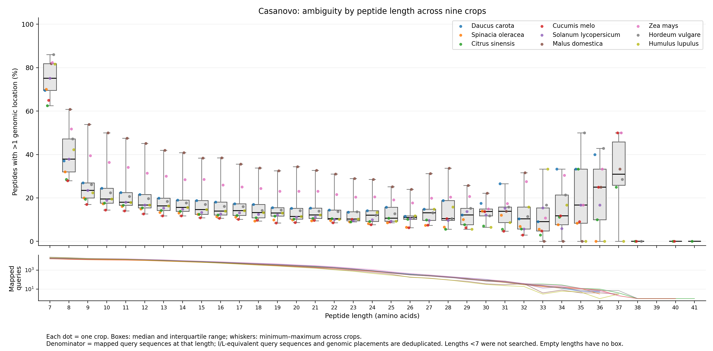
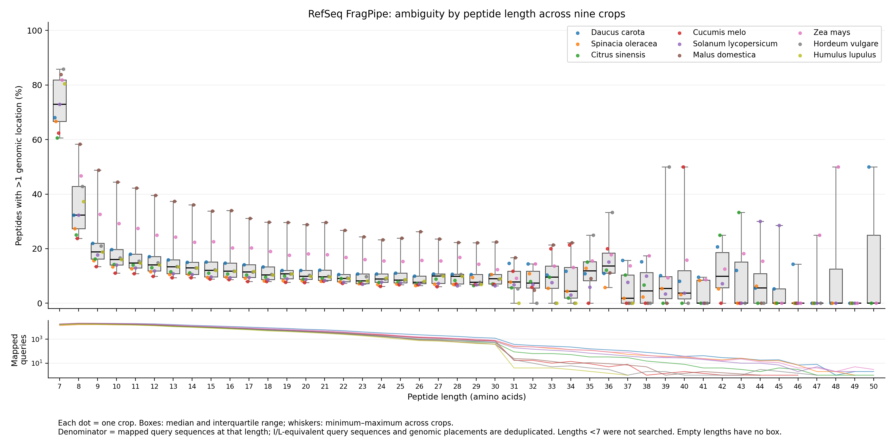

# RefSeq peptide runs and annotation-removal results

All nine production runs completed using the previous assembly, Helixer annotation, BAM and mapping settings, with the supplied RefSeq FragPipe peptide files. The same-frame refinement classification fix affects proposal labels, not genomic mapping.

| Species | Searched | Mapped | Mapped % | Multiply mapped % of mapped | Runtime (min) |
|---|---:|---:|---:|---:|---:|
| Daucus carota | 236,631 | 236,539 | 99.96 | 20.81 | 33.6 |
| Spinacia oleracea | 172,838 | 172,810 | 99.98 | 16.74 | 32.7 |
| Citrus sinensis | 172,029 | 171,895 | 99.92 | 17.94 | 30.3 |
| Cucumis melo | 192,501 | 192,448 | 99.97 | 15.63 | 35.3 |
| Solanum lycopersicum | 200,334 | 200,088 | 99.88 | 18.88 | 20.2 |
| Malus domestica | 192,952 | 192,813 | 99.93 | 44.38 | 24.9 |
| Zea mays | 223,529 | 223,375 | 99.93 | 30.92 | 30.6 |
| Hordeum vulgare | 187,369 | 187,329 | 99.98 | 23.96 | 33.1 |
| Humulus lupulus | 163,718 | 163,662 | 99.97 | 22.92 | 20.2 |

Production counts above refer to normalized query sequences; the ambiguity figures additionally collapse I/L-equivalent query aliases.

## Blinded annotation-removal benchmark

| Species | Genes | Exact peptide coordinates | Exact full CDS | Exact splice chain (multi-exon) | Junction recall | Junction precision |
|---|---:|---:|---:|---:|---:|---:|
| Daucus carota | 100 | 1325/1326 | 67/100 | 47/50 | 95.07% | 90.88% |
| Spinacia oleracea | 100 | 1451/1451 | 65/100 | 43/50 | 96.84% | 89.87% |
| Citrus sinensis | 100 | 1227/1228 | 63/100 | 39/50 | 93.27% | 91.72% |
| Cucumis melo | 100 | 1353/1353 | 59/100 | 46/50 | 98.08% | 89.50% |
| Solanum lycopersicum | 100 | 1190/1194 | 59/100 | 39/50 | 91.59% | 86.16% |
| Malus domestica | 100 | 1050/1054 | 49/100 | 39/50 | 86.24% | 86.24% |
| Zea mays | 100 | 1157/1169 | 55/100 | 37/50 | 86.36% | 92.04% |
| Hordeum vulgare | 100 | 1131/1132 | 52/100 | 40/50 | 88.93% | 86.69% |
| Humulus lupulus | 100 | 1105/1113 | 48/100 | 31/50 | 80.55% | 85.21% |

Pooled exact peptide-coordinate recall: **99.72%**. Exact full-CDS recovery: **57.44%**. Full coding splice-chain recovery among multi-exon targets: **80.22%**.

These are different tasks. Correct peptide placements do not establish complete CDS structures. Full-CDS recovery requires one peptide-supported RNA model to match the complete strand-aware coding path; merely reporting an ORF at the locus does not count.

Read [the protocol](README.md) before interpreting these values. Targets are deterministic, stratified samples of peptide-supported annotated genes, not a random sample of all genes. Reference peptide identification predates masking. Candidate junctions unmatched to the selected target isoform can be legitimate alternative isoforms; this precision is concordance with withheld annotations, not a genome-wide biological false-discovery rate.

The weaker ORF-presence criterion would count **741/900 genes (82.3%)** as rediscovered because they have at least one peptide-supported overlapping RNA candidate. Only **517/900 (57.4%)** match the complete target CDS. Individual splice-junction recall is **90.78%**, and concordance precision against the selected target structures is **88.68%**.

All **11,020 expected peptide-coordinate paths** passed independent nucleotide projection and BioPython translation checks. **31/31 unrecovered paths** require junctions absent from the search evidence. Retained-annotation overlap checks and cached RNA/input identity checks passed for all crops.

Fresh projected TransDecoder CDS structure multisets shared **96.0–99.7%** with the previous predictions. Assembled RNA exon structures were identical in all crops (see RNA_exon_structure_comparison.json). Fresh ORF counts are therefore not a perfectly isolated peptide-list comparison; the held-out benchmark uses fixed RNA predictions to avoid this confound.

All production validations passed, including independent translation of **18,000 sampled peptide mappings** and **18,000 sampled whole candidate coding paths**.

## Figures

Each box represents the crop-level distribution at one peptide length, with individual crop dots and mapped-query sample sizes. All observed lengths are included; lengths below seven were not searched.

Vector PDF/SVG files and crop-by-length count/percentage TSV files accompany each PNG.
